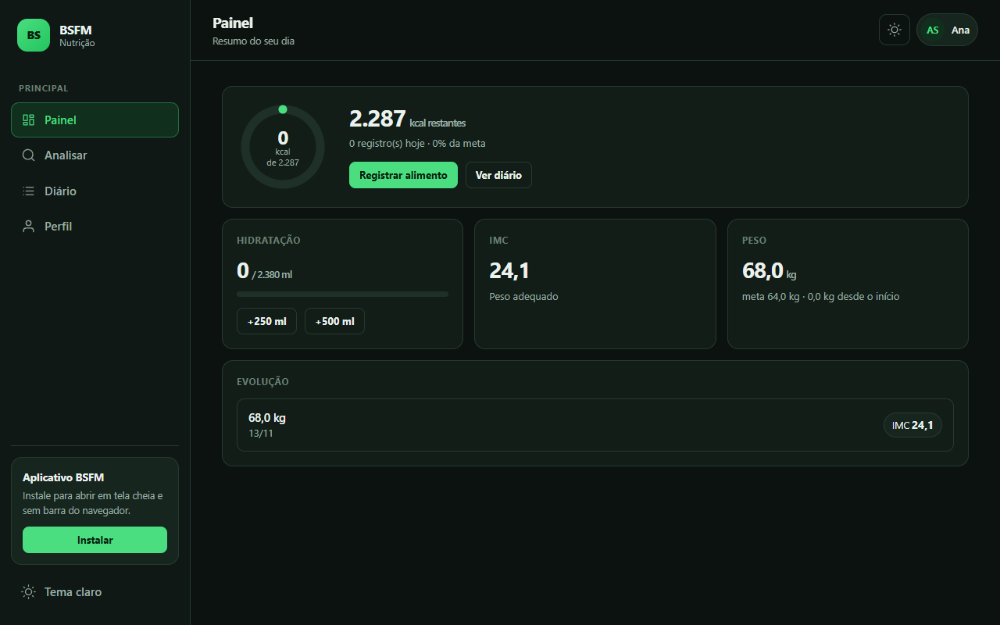
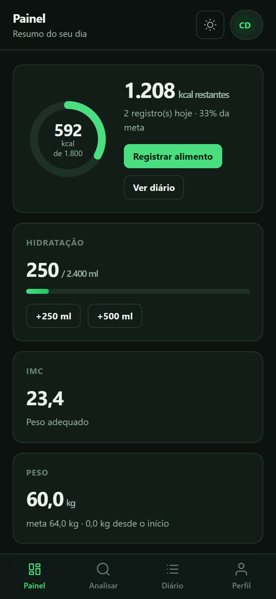
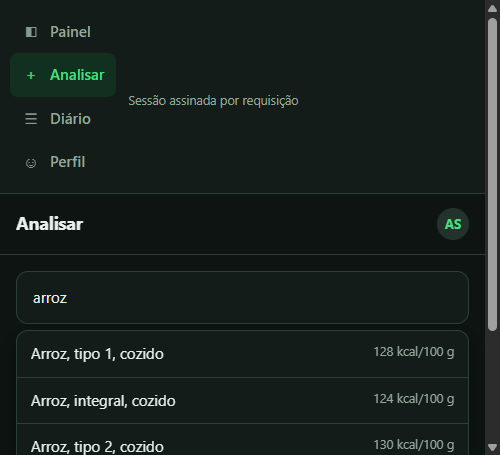

# Engenharia e Remodelagem

Registro técnico da remodelação do BSFM: o que foi observado no sistema original,
o que foi decidido, o que foi construído e como cada afirmação foi verificada.

Esta seção existe para que a próxima pessoa (ou a banca) consiga auditar as decisões
sem depender de memória de conversa.

---

## Como ler

Cada documento separa explicitamente três coisas:

- **observado** — veio de execução, leitura de código ou captura com evidência;
- **inferido** — conclusão razoável, mas não provada;
- **desconhecido** — o que ainda não foi medido.

Nenhum número aparece aqui sem uma suíte que o produza.

---

## Os seis documentos

| # | Documento | Responde |
|---|---|---|
| 01 | [Engenharia reversa do site de referência](01-engenharia-reversa.md) | como o Google AI Studio Docs estrutura navegação, design e conteúdo — e o que copiar |
| 02 | [Análise do app original](02-analise-do-app.md) | inventário do código, 33 rotas anônimas e os cinco achados P0 de segurança |
| 03 | [Schema e migração](03-schema-e-migracao.md) | 14 tabelas, migrations Postgres, cascatas e o que fazer antes de aplicar |
| 04 | [Rotas e testes](04-rotas-e-testes.md) | migração para controllers, erro padronizado e testes idempotentes |
| 05 | [Camada nutricional](05-camada-nutricional.md) | por que o YOLO saiu do centro e como o catálogo passou a produzir os números |
| 06 | [Base TACO](06-base-taco.md) | 582 alimentos importados, ranqueamento por preparo e a chave de assinatura por sessão |
| 07 | [Deploy no Render](07-deploy.md) | variáveis de ambiente e diagnóstico dos erros de cadastro e e-mail |
| 08 | [Paridade com o original](08-paridade.md) | comparação tela a tela entre o site antigo e o novo, e o que foi restaurado |
| 09 | [Inventário completo da v1](09-inventario-v1.md) | 73 arquivos, 35 endpoints, 11 páginas e a lista priorizada de lacunas |

---

## O resultado em números

| Item | Valor |
|---|---|
| Tabelas no schema v2 | 14 |
| Alimentos no catálogo | 582 |
| Rotas migradas para controllers | 29 |
| Asserções automatizadas | **281, todas passando** |
| Telas no front React | 8 (Landing, Entrar, Criar conta, Painel, Analisar, Diário, Planos, Metas, Perfil) |

---

## O front

Mesmo código no computador e no celular: o que muda é o layout.

**Desktop** — sidebar fixa, cartões de métricas e tema claro/escuro.

**Celular** — barra inferior de navegação, alvos de toque grandes e área segura.

**Instalável** — o app abre em tela cheia, com ícone próprio e shell offline.

---

## As cinco falhas corrigidas

| Antes | Depois |
|---|---|
| `/esqueci-senha` devolvia o código na resposta HTTP | 202 sempre, código só por e-mail |
| `/redefinir-senha` não validava token algum | exige código TOTP válido |
| `PUT /usuario/atualizar-senha` trocava a senha de qualquer `id` | `/api/eu/senha` exige senha atual |
| sessão era um JSON no `localStorage` | JWT + sessão no banco + assinatura por requisição |
| CORS `AllowAnyOrigin` em API de dados de saúde | origem explícita por configuração |

---

## Repositórios

- **Aplicação:** [BSFM-APP](https://github.com/Brazilian-System-of-Food-Metric/BSFM-APP) — v2 em `v2/`
- **Documentação:** este repositório
